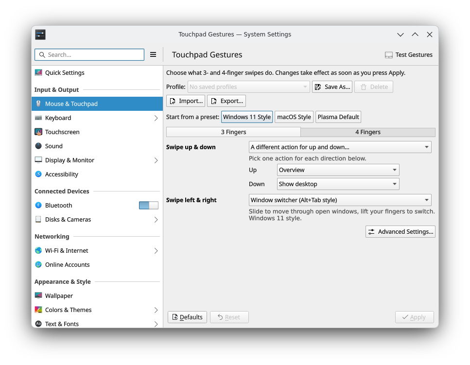

# Swyper

**Yes, swiping!** Touchpad gestures for KDE Plasma.

Swyper lets you choose what 3- and 4-finger touchpad swipes do, right in System Settings.
Plasma's own gestures, like Overview and desktop switching, keep their smooth animations that follow your fingers.



## Features

- Windows- and macOS-style touchpad gestures on KDE Plasma.
- Set your own gestures to do whatever you like, with the same fluid feel and ease of use as Plasma's native gestures.

Out of the box nothing changes. Pick your gestures in *System Settings › Mouse & Touchpad › Touchpad Gestures*.

## Requirements

- KDE Plasma 6 on Wayland (developed and tested on Plasma 6.8).
- A touchpad that tracks at least 4 fingers.

## Install

### Arch Linux, CachyOS, Manjaro, EndeavourOS

```
paru -S swyper-plasma
```

(or `yay -S swyper-plasma`). Then log out and back in once.

### Other distributions

Packages for other distributions are planned. Until then you can build it yourself.
You need CMake, extra-cmake-modules, a C++ compiler, and the development files for KWin, Qt 6 and KDE Frameworks 6
(KCMUtils, Kirigami, KConfig, KCoreAddons, KI18n), plus `vulkan-headers`, which KWin's build files expect.

```
cmake -B build -DCMAKE_BUILD_TYPE=Release -DCMAKE_INSTALL_PREFIX=/usr
cmake --build build
sudo cmake --install build
```

Then log out and back in once. When you build it yourself, rebuild it after every KWin update.

## How updates are handled

KWin plugins have to be built for the exact KWin version they run in. Swyper takes care of that:

- **Automatic rebuild.** The Arch package ships the source and rebuilds Swyper on your machine right after every KWin update, during the update itself.
- **Safety lock.** Swyper checks that it was built for the KWin that is running. If not, it pauses itself and shows a notification, and Plasma's standard gestures keep working. A mismatch never breaks your desktop.

## Privacy

Swyper has no telemetry and never uses the network. Your settings are stored only in `~/.config/swyperrc`
and your profiles in `~/.local/share/swyper/profiles/`.

## License

GPL-3.0-or-later. See [LICENSE](LICENSE).

Swyper is an independent project. It is not affiliated with or endorsed by KDE e.V.
KDE is a registered trademark of KDE e.V.
